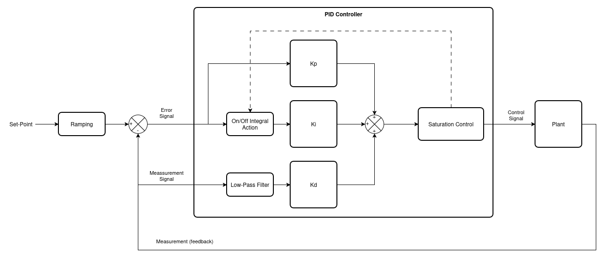
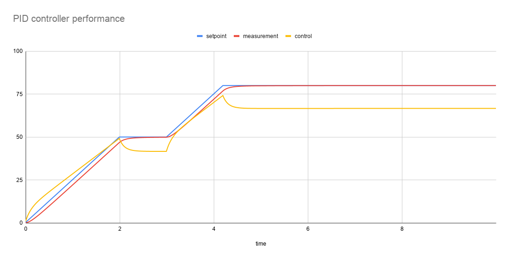

# Industrial PID Controller Module

## Overview

The **Proportional-Integral-Derivative (PID)** controller is a robust, industrial-grade closed-loop feedback mechanism designed for efficient, discrete-time control systems. Written in C with zero hardware dependencies, it incorporates advanced safety and filtering features such as dynamic anti-windup clamping, derivative kick mitigation, and an intelligent setpoint ramp generator to guarantee smooth regulation and reliable performance in demanding embedded applications.

The diagram below illustrates the controller's internal block architecture:



### Key Features

* **Anti-Windup Protection:** Implements dynamic clamping and conditional integration blocking. When output saturation (`out_min`, `out_max`) is reached, integral accumulation is conditionally halted to prevent windup and guarantee fast recovery.


* **Filtered Derivative & Kick Mitigation:** Calculates the derivative term exclusively on the process variable (measurement) rather than error to eliminate step discontinuities ("derivative kick"). Includes a discrete first-order low-pass filter (governed by coefficient $N$) to reject high-frequency sensor noise.


* **Intelligent Setpoint Rate Limiter:** Features a smart ramp generator that smooths out step changes in target setpoints, executing rate limiting dynamically until stabilization is reached.


* **Quality & Verification:** Verified using a Ceedling/Unity complemented by Doxygen-compatible inline documentation.


---

## Controller Performance & Simulation

The following response graph demonstrates the closed-loop behavior of the PID controller interacting with a simulated process plant. It showcases clean setpoint tracking via the intelligent rate limiter, smooth transient response, and effective output regulation without integral windup during step transitions:

---

## Project Structure

```text
pid_controller/
├── docs/                 # Doxygen configuration and block diagrams
├── pid.h                 # Public API
├── pid.c                 # PID algorithm implementation
├── test/                 # Unit testing environment
│   ├── support/          # Auxiliary headers and Ceedling mocks
│   ├── project.yml       # Ceedling project configuration
│   └── test_pid.c        # Unit test suite for PID logic
└── README.md             # Main project documentation

```

---

## Integration and Getting Started

### Integration Scheme

The PID controller is structured as a pure mathematical control block. Integration consists of instantiating the `pid_controller_t` context structure, initializing parameters via `pid_init()`, and executing `pid_compute()`.

---

### Integration Steps

1. Copy `pid.h` and `pid.c` into your project's source tree and add them to your build system (CMake, Makefile, IDE).


2. Include `"pid.h"` in your application module.


3. Declare a `pid_controller_t` instance.


4. Call `pid_init()` passing your desired tuning constants ($K_p, K_i, K_d, N$), sample time $dt$, output limits, and ramp rate.


5. Periodically invoke `pid_compute(&pid, setpoint, measurement)` inside your control loop at intervals equal to $dt$.


---

### Code Examples

#### Example Usage

The following example demonstrates how to initialize the PID controller, run a plant simulation loop, handle setpoint ramping, and output the tracking data to a CSV file.

```c
/**
 * @file main.c
 * @brief PID Controller Simulation Application with Smooth Ramping and Optimal Tuning.
 * 
 * SPDX-License-Identifier: MIT
 */

#include <stdio.h>
#include <stdlib.h>
#include <stdbool.h>
#include "pid.h"

/**
 * @brief Simulates a first-order physical plant response.
 * @param[in] u Control effort (output from PID).
 * @param[in] dt Sampling period in seconds.
 * @return Current process measurement value.
 */
static float simulate_plant(float u, float dt) {
    static float y = 0.0f;
    float K = 1.2f;       // Plant static gain
    float tau = 0.5f;     // Process time constant
    y += (dt / tau) * (K * u - y);
    return y;
}

int main(void) {
    pid_controller_t my_pid;
    
    // Optimal tuning parameters for clean tracking:
    // Kp=3.5, Ki=6.0, Kd=0.02, N=10.0, dt=0.01s, 
    // Out [0, 100], AntiWindup=true, SetpointRate=25.0 units/s (smooth ramp)
    float dt = 0.01f;
    if (pid_init(&my_pid, 3.5f, 6.0f, 0.02f, 10.0f, dt, 0.0f, 100.0f, true, 25.0f) != 0) {
        fprintf(stderr, "Failed to initialize PID controller\n");
        return 1;
    }

    float setpoint = 50.0f;
    float measurement = 0.0f;
    float output = 0.0f;

    // Open file to export data for plotting
    FILE *csv = fopen("pid_simulation.csv", "w");
    if (csv == NULL) {
        perror("Error opening file");
        return 1;
    }
    
    fprintf(csv, "time,setpoint,measurement,output\n");

    // Simulation of 1000 steps (10 seconds at 100Hz)
    for (int i = 0; i < 1000; i++) {
        float time = i * dt;

        // Trigger a target setpoint step change at 3.0 seconds
        if (i == 300) {
            setpoint = 80.0f;
        }

        // Execute the PID controller (internally handles the setpoint ramping)
        output = pid_compute(&my_pid, setpoint, measurement);
        
        // Simulate process physical response
        measurement = simulate_plant(output, dt);

        // Save results (exporting my_pid.setpoint_current to visualize the smooth ramp)
        fprintf(csv, "%.2f,%.2f,%.2f,%.2f\n", time, my_pid.setpoint_current, measurement, output);
    }

    fclose(csv);
    printf("Simulation completed successfully. Data saved to 'pid_simulation.csv'\n");
    return 0;
}

```

The following image illustrates the controller's performance in one of the executed simulations:



---

## Running Unit Tests

The development environment uses **Ceedling** (along with **Unity** and **CMock**) for hardware-decoupled unit testing.

### Prerequisites

* **Ruby** (for executing the Ceedling engine)
* **Ceedling** (unit testing framework for C)
* **gcovr** (optional, for coverage reporting)

### Execution Commands

1. Navigate to the test directory:

```bash
cd test

```

2. Run the full unit test suite:

```bash
ceedling test:all

```

3. Generate code coverage report:

```bash
ceedling gcov:all

```

The resulting HTML report will be available at:
`test/build/artifacts/gcov/gcovr/index.html`

---

## Generating Documentation

The public API is fully documented using **Doxygen**-compatible comment blocks.

### Option 1: Via Command Line

1. Navigate to the `docs/` directory:

```bash
cd docs

```

2. Build the documentation using the `doxyfile` configuration file:

```bash
doxygen doxyfile

```

3. Open the generated file in your web browser:

```bash
xdg-open html/index.html

```

### Option 2: Via Graphical User Interface

1. Launch Doxywizard from the terminal:

```bash
doxywizard

```

2. Select **File > Open** and open the `doxyfile` inside the `docs/` directory.
3. Select the **Run** tab -> Click **Run doxygen**.
4. Open `html/index.html` in your browser.

---

## License

This project is distributed under the **MIT** License.